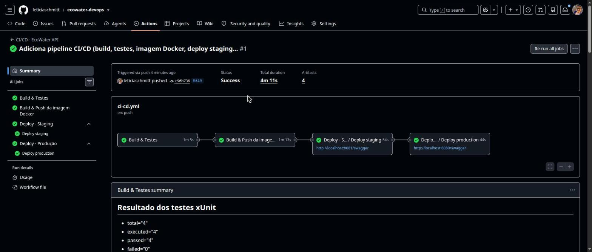
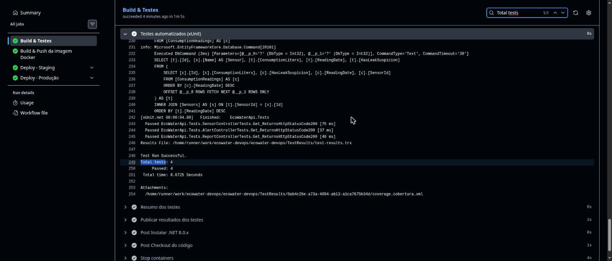
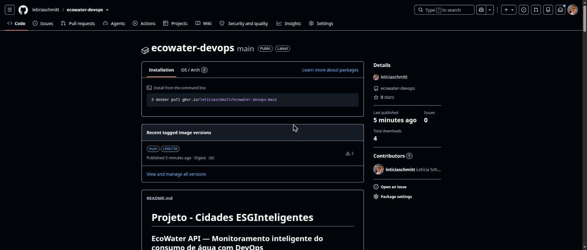
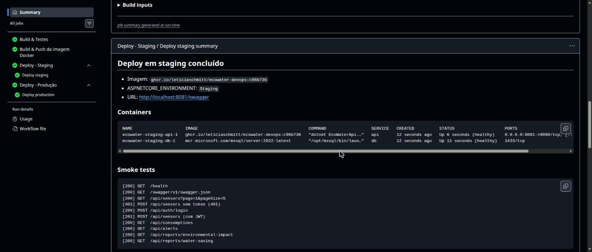
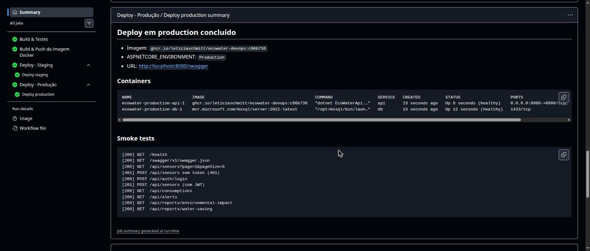

# Projeto - Cidades ESGInteligentes

## EcoWater API — Monitoramento inteligente do consumo de água com DevOps

**Integrante:** Letícia Schmitt Rocha
**Tema ESG:** Acesso à água e preservação de recursos naturais
**Stack:** ASP.NET Core 8 · SQL Server 2022 · Docker · GitHub Actions

A EcoWater API registra leituras de sensores de consumo de água, gera alertas automáticos de desperdício e disponibiliza relatórios de impacto ambiental. Nesta entrega, o projeto (desenvolvido no Desafio de ASP.NET Core 8) recebeu um ciclo DevOps completo: containerização, orquestração com Docker Compose e pipeline CI/CD com deploy automatizado em **staging** e **produção**.

> A documentação funcional da API (endpoints, arquitetura MVVM, JWT, paginação) está em [`src/EcoWaterApi/README.md`](src/EcoWaterApi/README.md).

---

## Como executar localmente com Docker

**Pré-requisitos:** Docker Desktop (ou Docker Engine + Docker Compose v2).

```bash
# 1. Clonar o repositório
git clone https://github.com/leticiaschmitt/ecowater-devops.git
cd ecowater-devops

# 2. Criar o arquivo de variáveis de ambiente
cp .env.example .env          # ajuste DB_PASSWORD e JWT_KEY se quiser

# 3. Subir a aplicação + banco
docker compose up -d --build

# 4. Acompanhar a inicialização (as migrations são aplicadas automaticamente)
docker compose ps
docker compose logs -f api
```

Acesse:

| Recurso | URL |
|---|---|
| Swagger | http://localhost:8080/swagger |
| Health check | http://localhost:8080/health |
| Exemplo de listagem paginada | http://localhost:8080/api/sensors?page=1&pageSize=10 |

Testar rapidamente todos os endpoints principais (o mesmo script que o pipeline usa):

```bash
./scripts/smoke-test.sh http://localhost:8080 evidencias/local
```

Encerrar:

```bash
docker compose down        # mantém os dados (volume sqldata)
docker compose down -v     # remove também o volume do banco
```

Para rodar os testes fora do Docker é preciso um SQL Server acessível (por exemplo, o próprio container `db`):

```bash
export ConnectionStrings__DefaultConnection="Server=localhost,1433;Database=EcoWaterDb_Test;User Id=sa;Password=<senha>;TrustServerCertificate=True;"
dotnet test
```

---

## Pipeline CI/CD

**Ferramenta:** GitHub Actions — arquivos em [`.github/workflows/`](.github/workflows).

| Arquivo | Função |
|---|---|
| `ci-cd.yml` | Pipeline principal: build, testes, imagem Docker e orquestração dos deploys |
| `deploy.yml` | Workflow reutilizável de deploy, chamado uma vez para cada ambiente |

### Gatilhos

- `push` nas branches `main` e `develop`
- `pull_request` para `main` (executa apenas build e testes)
- `workflow_dispatch` (execução manual pela aba *Actions*)

### Etapas

```
push ─▶ [1] Build & Testes ─▶ [2] Imagem Docker ─▶ [3] Deploy Staging ─▶ [4] Deploy Produção
          (SQL Server real)     (push no GHCR)       (+ smoke tests)       (somente main,
                                                                            + smoke tests)
```

1. **Build & Testes** — `dotnet restore`, `dotnet build -c Release` e `dotnet test`. Um SQL Server 2022 sobe como *service container* do job, então os testes xUnit (`WebApplicationFactory`) rodam contra um banco real, com as migrations aplicadas automaticamente. Os resultados (`.trx`) e a cobertura são publicados como artefato `test-results`, e o resumo aparece na página da execução.
2. **Build & Push da imagem** — constrói o `Dockerfile` com Buildx (com cache) e publica no **GitHub Container Registry** com duas tags: o SHA curto do commit (imutável, usado nos deploys) e o nome da branch.
3. **Deploy Staging** — usa o GitHub Environment `staging`. Gera o arquivo de ambiente a partir dos *secrets*, baixa **a mesma imagem** testada, sobe a stack com `docker compose up --wait` (porta 8081, `ASPNETCORE_ENVIRONMENT=Staging`, banco `EcoWaterDb_Staging`) e executa os smoke tests.
4. **Deploy Produção** — usa o GitHub Environment `production` e só roda na branch `main`, depois que staging passou. É possível exigir **aprovação manual** antes do deploy (Settings → Environments → production → *Required reviewers*). Sobe na porta 8080 com `ASPNETCORE_ENVIRONMENT=Production` e repete os smoke tests.

### Smoke tests executados em cada ambiente

`scripts/smoke-test.sh` valida: `/health`, Swagger, listagem paginada de sensores, bloqueio sem token (401), login JWT, criação de sensor autenticada (201), consumos, alertas e os dois relatórios ambientais. Respostas, logs da API e `docker compose ps` são publicados como artefatos `evidencias-staging` e `evidencias-production`.

### Estratégia de ambientes

Os ambientes de staging e produção são provisionados sob demanda nos runners do GitHub: cada deploy sobe uma stack isolada (projeto Compose próprio, banco próprio, porta e configuração próprias), valida e registra as evidências, e encerra ao final. O mesmo `docker-compose.yml` + arquivo `.env` por ambiente pode ser usado sem alterações em uma VM ou servidor de nuvem: bastaria trocar a etapa de deploy por um `docker compose up` remoto (via SSH, por exemplo).

### Como validar os ambientes (avaliação)

Os deploys de staging e produção ficam registrados e podem ser conferidos e reproduzidos:

| O que conferir | Onde |
|---|---|
| Execuções do pipeline (build, testes, deploys) | https://github.com/leticiaschmitt/ecowater-devops/actions |
| Histórico de deploys por ambiente (staging / production) | https://github.com/leticiaschmitt/ecowater-devops/deployments |
| Imagem Docker publicada (pública) | https://github.com/leticiaschmitt/ecowater-devops/pkgs/container/ecowater-devops |
| Logs dos deploys e dos smoke tests | pasta [`evidencias/`](evidencias) e artefatos `evidencias-staging` / `evidencias-production` de cada execução |

**Reproduzir o ambiente de produção em qualquer máquina com Docker**, usando exatamente a imagem que o pipeline publicou (sem compilar nada):

```bash
git clone https://github.com/leticiaschmitt/ecowater-devops.git && cd ecowater-devops
cp .env.example .env
API_IMAGE=ghcr.io/leticiaschmitt/ecowater-devops:main ASPNETCORE_ENVIRONMENT=Production docker compose up -d --no-build --wait
./scripts/smoke-test.sh http://localhost:8080 evidencias/local   # mesmos testes do pipeline
```

Depois é só acessar http://localhost:8080/swagger.

### Configuração no GitHub (uma vez)

1. **Settings → Actions → General → Workflow permissions:** marcar *Read and write permissions* (necessário para publicar a imagem no GHCR).
2. **Settings → Environments:** criar `staging` e `production`.
3. Em cada ambiente, opcionalmente, cadastrar os secrets `DB_PASSWORD` e `JWT_KEY` (se não existirem, o pipeline usa valores padrão de demonstração).
4. Em `production`, opcionalmente, adicionar *Required reviewers* para exigir aprovação antes do deploy.

---

## Containerização

### Dockerfile

```dockerfile
# ---------- Etapa 1: build/publish com o SDK do .NET 8 ----------
FROM mcr.microsoft.com/dotnet/sdk:8.0 AS build
WORKDIR /src
COPY src/EcoWaterApi/EcoWaterApi.csproj src/EcoWaterApi/
RUN dotnet restore src/EcoWaterApi/EcoWaterApi.csproj
COPY src/EcoWaterApi/ src/EcoWaterApi/
RUN dotnet publish src/EcoWaterApi/EcoWaterApi.csproj -c Release -o /app/publish --no-restore /p:UseAppHost=false

# ---------- Etapa 2: runtime enxuto (somente ASP.NET Core) ----------
FROM mcr.microsoft.com/dotnet/aspnet:8.0 AS runtime
RUN apt-get update \
    && apt-get install -y --no-install-recommends curl \
    && rm -rf /var/lib/apt/lists/*
WORKDIR /app
ENV ASPNETCORE_URLS=http://+:8080 \
    ASPNETCORE_ENVIRONMENT=Production \
    DisableHttpsRedirection=true
COPY --from=build /app/publish .
USER app
EXPOSE 8080
HEALTHCHECK --interval=15s --timeout=5s --start-period=40s --retries=5 \
    CMD curl -fs http://localhost:8080/health || exit 1
ENTRYPOINT ["dotnet", "EcoWaterApi.dll"]
```

### Estratégias adotadas

- **Multi-stage build:** o SDK (~800 MB) fica só na etapa de build; a imagem final usa apenas o runtime do ASP.NET Core.
- **Cache de camadas:** o `.csproj` é copiado e restaurado antes do código, então o `restore` só roda de novo quando as dependências mudam.
- **Segurança:** a aplicação roda com o usuário sem privilégios `app`; senhas e chaves JWT vêm de variáveis de ambiente (não ficam na imagem); `.dockerignore` impede que `.env`, `bin/` e `obj/` entrem no contexto do build.
- **Health check:** endpoint `/health` adicionado à API e usado pelo `HEALTHCHECK` do Docker, pelo `docker compose --wait` e pelos smoke tests.
- **Migrations automáticas:** ao iniciar, a API aplica as migrations do Entity Framework, com novas tentativas enquanto o SQL Server ainda está subindo.

### Orquestração (`docker-compose.yml`)

| Serviço | Imagem | Detalhes |
|---|---|---|
| `db` | `mcr.microsoft.com/mssql/server:2022-latest` | Volume nomeado `sqldata` para persistência; health check com `sqlcmd`; **não** expõe porta ao host |
| `api` | `ecowater-api` (build local) ou imagem do GHCR | `depends_on` com `condition: service_healthy`; porta configurável (`API_PORT`) |

- **Volumes:** `sqldata` → `/var/opt/mssql` (os dados sobrevivem a `docker compose down` e a novos deploys).
- **Redes:** `backend` (API ↔ banco, interna) e `frontend` (publicação da API).
- **Variáveis de ambiente:** `.env` (local, a partir de `.env.example`) ou `deploy/<ambiente>.env` (gerado pelo pipeline): `ASPNETCORE_ENVIRONMENT`, `API_PORT`, `API_IMAGE`, `DB_NAME`, `DB_PASSWORD`, `JWT_KEY`, `JWT_ISSUER`, `JWT_AUDIENCE`.

---

## Prints do funcionamento

> As imagens ficam na pasta [`docs/prints/`](docs/prints). Link da execução do pipeline: `https://github.com/leticiaschmitt/ecowater-devops/actions`

| Evidência | Print |
|---|---|
| Pipeline completo: 4 jobs verdes em 4min11s |  |
| Build e testes xUnit (4 de 4 aprovados) |  |
| Imagem publicada no GHCR |  |
| Deploy em staging: containers healthy + smoke tests |  |
| Deploy em produção: containers healthy + smoke tests |  |

---

## Tecnologias utilizadas

| Categoria | Tecnologias |
|---|---|
| Linguagem / Framework | C#, ASP.NET Core 8 (Web API), arquitetura MVVM |
| Persistência | SQL Server 2022, Entity Framework Core 8, Migrations |
| Segurança | JWT Bearer Authentication |
| Documentação da API | Swagger / OpenAPI (Swashbuckle), coleção Postman |
| Testes | xUnit, Microsoft.AspNetCore.Mvc.Testing, Coverlet |
| Containerização | Docker (multi-stage), Docker Compose |
| CI/CD | GitHub Actions, GitHub Environments, GitHub Container Registry (GHCR) |
| Scripts | Bash + curl (smoke tests) |

---

## Estrutura do projeto

```
ecowater-devops/
├── .github/workflows/
│   ├── ci-cd.yml              # pipeline principal
│   └── deploy.yml             # deploy reutilizável (staging/produção)
├── deploy/
│   ├── staging.env.example
│   └── production.env.example
├── docs/
│   ├── prints/                # evidências (prints)
│   └── EcoWater_API.postman_collection.json
├── evidencias/                # logs dos deploys (staging e produção) e dos testes
├── src/
│   ├── EcoWaterApi/           # código-fonte da API (ASP.NET Core 8, MVVM)
│   └── EcoWaterApi.Tests/     # testes xUnit
├── scripts/smoke-test.sh
├── Dockerfile
├── docker-compose.yml
├── .env.example
├── .dockerignore
├── EcoWater.sln
└── README.md
```

---

## Checklist de entrega

| Item | OK |
|---|---|
| Projeto compactado em .ZIP com estrutura organizada | ☑ |
| Dockerfile funcional | ☑ |
| docker-compose.yml ou arquivos Kubernetes | ☑ |
| Pipeline com etapas de build, teste e deploy | ☑ |
| README.md com instruções e prints | ☑ |
| Documentação técnica com evidências (PDF ou PPT) | ☑ |
| Deploy realizado nos ambientes staging e produção | ☑ |
